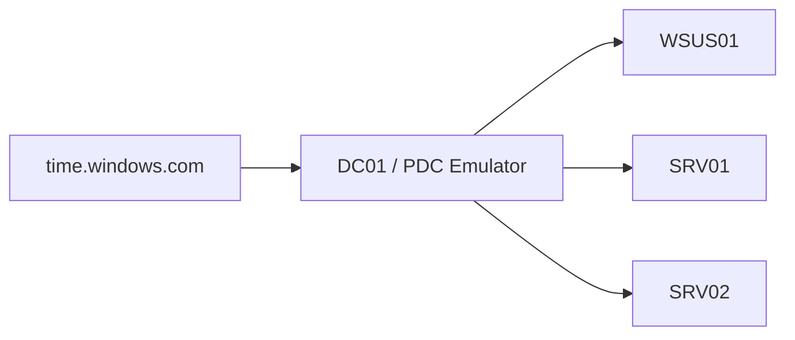

# Lab architecture

This summary is reconstructed from the implemented lab and change evidence; it is not a contemporaneous installation transcript.

## Host and network

- Windows 11 Hyper-V host; 32 GB RAM available on the host.
- Internal virtual switch: `PatchLab-Internal`.
- Lab subnet: `192.168.77.0/24`.
- Host virtual adapter/gateway: `192.168.77.1`.
- NAT: `PatchLab-NAT`.
- Guest operating system: Windows Server 2022 Datacenter Evaluation with Desktop Experience.

| VM | IPv4 | Function | Directory / deployment scope |
|---|---|---|---|
| DC01 | 192.168.77.10 | AD DS, DNS, PDC Emulator | Domain Controllers OU; Infrastructure group |
| WSUS01 | 192.168.77.20 | WSUS with IIS and WID | Management OU; Infrastructure group |
| SRV01 | 192.168.77.101 | Test member server | Lab-Servers / Pilot OU; Pilot group |
| SRV02 | 192.168.77.102 | Test member server | Lab-Servers / Broad OU; Broad group |

Domain: `ad.northstar.test`; NetBIOS name: `NORTHSTAR`. Lab clients use DC01 for DNS. An external DNS forwarder at `1.1.1.1` was configured during the build.

Some screenshots/API outputs identify the Broad member as `svr02.ad.northstar.test`, while the VM and local hostname are labeled SRV02. The patching work used the recorded WSUS computer GUID to correlate it. This publication retains the evidence rather than silently changing that observed name.

## Update management

- WSUS URL: `http://wsus01.ad.northstar.test:8530`.
- Content directory: `C:\WSUS`.
- Database: Windows Internal Database (WID).
- Product: Microsoft Server operating system-21H2.
- Classifications: Critical Updates, Security Updates, Update Rollups.
- Language: English; manual synchronization.
- Client-side targeting; automatic approval rule unchecked.
- Local content downloads after approval; express installation files disabled.

`WSUS-Pilot` and `WSUS-Broad` target their corresponding member OUs. `WSUS-Infrastructure` is linked to Management and Domain Controllers. All use AUOptions 3 (download and notify), with group approvals and no installation deadlines for the recorded changes. All Computers is kept unapproved.

## Time and logging

DC01 uses external NTP. The Windows Time VM provider is disabled on the three member servers so their demonstrated selected source is DC01. DC01's Hyper-V Time synchronization integration checkbox is disabled. Member-server Hyper-V checkboxes were left unchanged.

Firewall-Logging-Baseline is linked to Pilot and Broad. All three profiles log allowed and dropped traffic to separate files, with a 20,480 KB limit per profile. Runtime traffic evidence is from the Domain profile.

## Scope boundaries

This is a personal evaluation lab. The published HTTP WSUS endpoint and resource choices describe this implementation, not a production security baseline. No production application or second domain controller was deployed, and centralized log retention and alerting remain planned.
