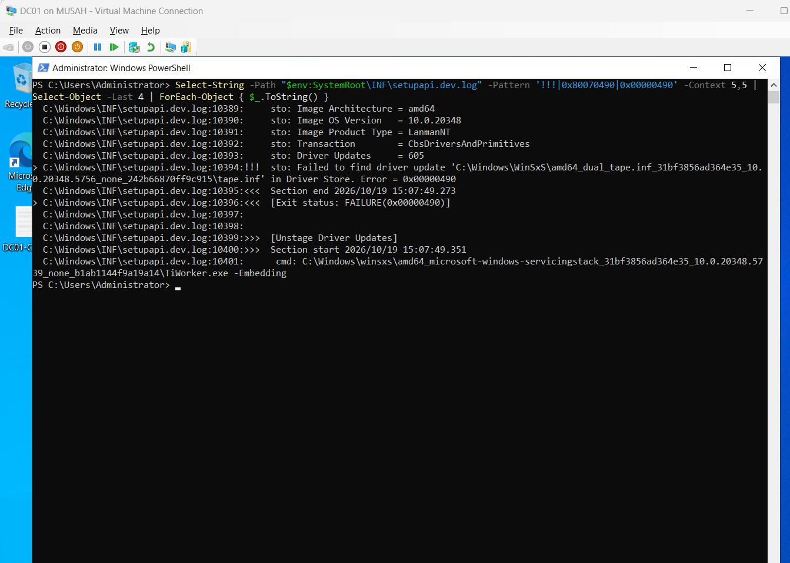
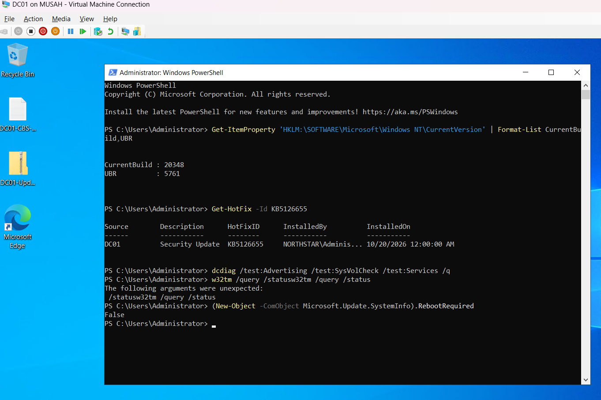

# Case study: DC01 October update rollback

## Problem

DC01 began on build 20348.587. After intermediate KB5030216 it reached 20348.1970, but the approved October OS update KB5126655 was not offered by managed scans and WSUS recorded NotApplicable.

A standalone Microsoft Catalog installation initially reported success and requested a restart. After restart, the OS remained at 20348.1970 and the hotfix was absent. Post-restart validation prevented the pre-restart installer message from being mistaken for completion.

## Evidence and investigation

Setup events recorded KB5126655 and KB5126654 failing to reach Installed with `0x80070490`. CBS then showed driver processing failure and rollback. SetupAPI identified the newer `tape.inf` package in the failed Driver Store lookup.

Read-only checks found an existing registered inbox tape driver, old/new INF files in WinSxS and Driver Store folders, and matching SHA-256 hashes for corresponding versions. Those results did not prove complete package registration. DISM ScanHealth reported no component-store corruption.

A PnPUtil import attempt was rejected for missing signature information and added zero packages. It was an unsuccessful troubleshooting step, not a repair. Signature enforcement was not bypassed, and driver files and servicing registry entries were not manually deleted or rewritten.

## Successful later path

1. Approved September OS update KB5122882 for Infrastructure.
2. Discovered, downloaded, and installed it through WSUS.
3. Restarted and verified build 20348.5622 and the hotfix entry.
4. A new managed scan offered October KB5126655.
5. Installed October through WSUS and restarted.
6. Confirmed build 20348.5761, KB5126655, successful latest history, no selected domain-controller test failures, and no Windows Update restart requirement.
7. Final WSUS summary reached 0 needed and 0 errors within the 91-update catalog.

## What the result does and does not show

The staged path succeeded in this lab. The evidence does not establish September as a universal October prerequisite or explain why the earlier driver transaction failed. The failed standalone attempt remains visible in history and should not be removed from the narrative.

The investigation also exposed a separate startup time-source observation. That issue was investigated through Time-Service events: DNS lookup failed initially, then automatic NTP retry recovered without manual resync. It was not attributed to the update rollback.

Full change record: [LAB-CHG-008](../03-Patch-Management/LAB-CHG-008.md). Raw diagnostic logs are retained locally and are not included in this publication.
