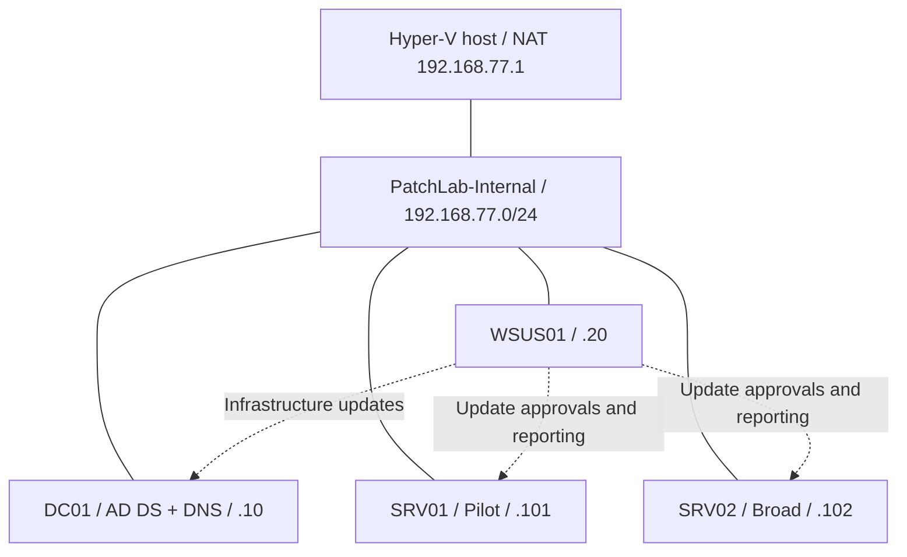
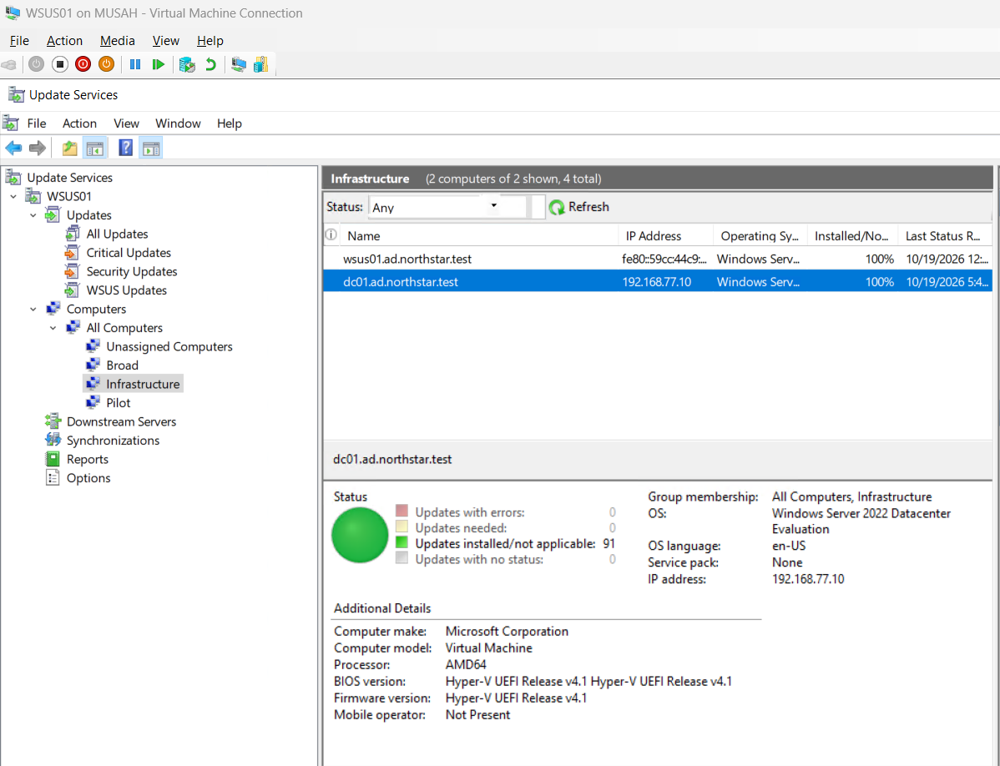
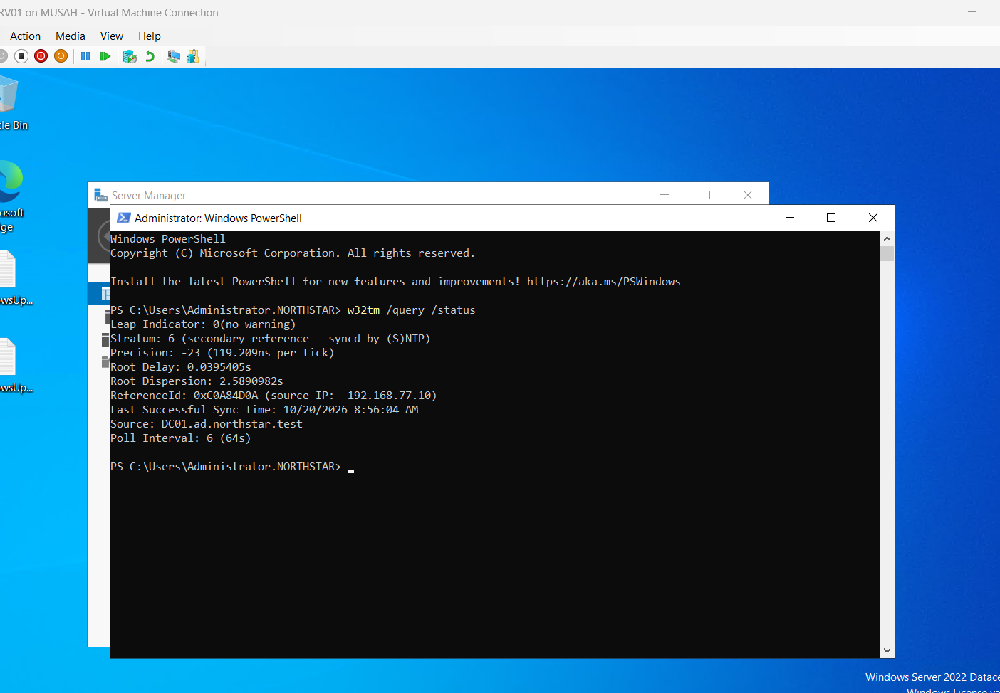

# Windows Server Patching and Security Lab

A personal Hyper-V lab demonstrating staged Windows Server patching, investigation of servicing failures, firewall logging, and domain time synchronization.

**Current work: Phase 4 — credentialed assessment and staged hardening.** SRV01/Pilot, SRV02/Broad, and WSUS01 validation is complete for three selected findings on each target; DC01 assessment remains pending. The v0.1 patching and monitoring baseline is retained as history.

## Results demonstrated

- Built a four-server Windows Server 2022 domain with AD DS, DNS, WSUS, and Group Policy.
- Deployed selected OS and .NET updates through Pilot, Broad, and Infrastructure groups.
- Verified all four servers at OS build **20348.5761**, with their final recorded WSUS summaries showing **0 needed, 91 installed/not applicable, 0 errors, and 0 unknown** per server.
- Investigated a DC01 update rollback using CBS, SetupAPI, package inventory, INF hashes, and DISM diagnostics; subsequently completed the update through a staged servicing path.
- Enabled firewall logging through Group Policy on SRV01 and SRV02 and verified real log entries.
- Verified member-server domain time selection after restarts and observed DC01 recover automatically from a startup DNS-resolution failure.

The 91-update summaries cover the lab's selected WSUS catalog. They are **not** a complete vulnerability assessment or a formal compliance score. Results are recorded observations from October 2026, not a claim of perpetual patch currency.

- Validated three selected Nessus findings on SRV01, SRV02, and WSUS01 through credentialed rescans after scoped hardening GPO deployments. WSUS01 also passed console connection and post-hardening synchronization checks. See the [Phase 4 report](04-Vulnerability-Remediation/README.md) for scope, evidence, and limitations.

## Project phases

Select a phase to view its documentation or planned work.

| Phase | Scope | Status |
|---|---|---|
| [**Phase 1 — Lab foundation**](02-Build-Notes/README.md) | Hyper-V networking, AD DS, DNS, WSUS, Group Policy | Completed; build summarized retrospectively |
| [**Phase 2 — Patch management**](03-Patch-Management/README.md) | Pilot, Broad, Infrastructure patch deployment and validation | Completed for selected updates |
| [**Phase 3 — Local monitoring**](05-Monitoring/README.md) | Local firewall logging and domain time synchronization | Completed within the documented test scope |
| [**Phase 4 — Vulnerability assessment**](04-Vulnerability-Remediation/README.md) | Vulnerability scanning, prioritization, remediation, rescan | In progress — Pilot/Broad and WSUS01 selected findings validated; DC01 pending |
| [**Phase 5 — Central monitoring**](ROADMAP.md#later-phase--central-monitoring) | Central log collection, alerts, recurring review | Planned |
| [**Phase 6 — Configuration Manager / MECM**](ROADMAP.md#later-phase--configuration-manager--mecm) | Configuration Manager / MECM deployment | Planned |

See the [roadmap](ROADMAP.md) for remaining work and milestone criteria.

## Architecture

| System | Address | Role | WSUS group |
|---|---|---|---|
| DC01 | 192.168.77.10 | AD DS, DNS, PDC Emulator | Infrastructure |
| WSUS01 | 192.168.77.20 | WSUS, IIS, Windows Internal Database | Infrastructure |
| SRV01 | 192.168.77.101 | Member server | Pilot |
| SRV02 | 192.168.77.102 | Member server | Broad |

Domain: `ad.northstar.test` · Hyper-V internal switch: `PatchLab-Internal` · Host gateway/NAT: `192.168.77.1`.

Details: [architecture](01-Architecture/README.md) and [build notes](02-Build-Notes/README.md).

## Read the completed work

| Area | Documentation |
|---|---|
| Staged patching and delivery sources | [Change register](03-Patch-Management/README.md) |
| Servicing rollback investigation | [DC01 case study](02-Build-Notes/DC01-Servicing-Investigation.md) |
| Firewall policy and traffic validation | [LAB-CHG-006](05-Monitoring/LAB-CHG-006.md) |
| Domain time configuration and restart testing | [LAB-CHG-009](05-Monitoring/LAB-CHG-009.md) |
| Credentialed scanning and Pilot-to-Broad hardening | [Phase 4 / LAB-CHG-010](04-Vulnerability-Remediation/README.md) |
| WSUS01 assessment and role validation | [LAB-CHG-011](04-Vulnerability-Remediation/LAB-CHG-011-WSUS01-Hardening.md) |
| Screenshots organized by outcome | [Evidence index](06-Evidence/README.md) |
| Current results across the project | [Milestone report](07-Final-Report/README.md) |

### Example evidence

DC01's final recorded Infrastructure summary:

Pilot member-server time selection after a restart:

## Delivery methods and limitations

The deployment sources are recorded explicitly: October's OS update used standalone Microsoft Catalog packages on SRV01/SRV02, while final October installation on WSUS01/DC01 succeeded through WSUS. The initial October detection issue on SRV01/SRV02 remains unexplained.

DC01's earlier standalone October attempt rolled back during driver processing. Installing September and then retrying October succeeded, but this sequence does not prove a universal prerequisite or a driver repair. A rejected PnPUtil attempt added no packages.

Time verification covers observed source selection and restarts, not a precision-time guarantee. Firewall validation covers local log generation on two servers; central collection and alerting are planned. No application workload was configured for application compatibility testing, and backup restoration was not tested.

This repository publishes documentation and screenshot evidence. VM disks, installers, credentials, private keys, and raw diagnostic archives are outside this milestone's publication scope.

## Continuing the project

Keep completed change records as history. Add new findings, changes, and validation in later commits; update the roadmap and milestone report when each phase is demonstrated. See [CONTRIBUTING.md](CONTRIBUTING.md) for the evidence convention.
